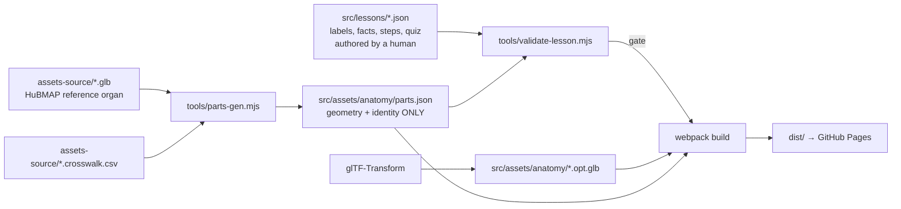

# Architecture

Three layers, and the whole point is that **the pedagogy is data, not code**. A new body
region should mean a new JSON file plus a new GLB — not a new code path.



## Files that matter

| Path | Role |
|---|---|
| `src/index.js` | entry point: picks the mode (`student` / `?level=ms` / `?debug=1` / `?demo=tutorial`), sets the desktop preview camera to the student's eye, exposes dev hooks **only when `DEBUG`** |
| `src/init.js` | WebXR boilerplate: renderer, `renderer.xr`, player rig, controllers; now also hands back `controls` so desktop preview can be posed |
| `src/lesson/text.js` | troika in-world text: panels, labels, leader lines. Owns the async-fit problem |
| `src/lesson/anatomy.js` | the model's verbs: load, bind registry, explode, isolate, ghost, highlight, assemble, pick, measure (`centre()`, `center(id)`, `radius(id)`) |
| `src/lesson/lesson.js` | the step state machine: prompts, feedback, labels, waypoints, flow/reassembly logic, kiosk `reset()` |
| `src/lessons/heart.json` | **the lesson**: steps, action verbs, names, vocab, flow path, quiz |
| `src/assets/anatomy/parts.json` | generated: per-part size, centre, ontology ID, explode vector. No teaching text |
| `tools/validate-lesson.mjs` | the contract check between the two files above |
| `tools/probe-anatomy.html` | standalone anatomy probe (dev only, not shipped in the lesson flow) |

## The split that keeps it honest

`parts.json` is **generated** from geometry. `src/lessons/*.json` is **authored** by a
human. They are never merged:

- the registry answers *"what is this geometry, how big is it, where does it go when it
  explodes"* — reproducible, regenerable, machine-true;
- the lesson answers *"what do we call this to a 14-year-old, what do we want them to
  notice, what misconception do we expect"* — editorial, reviewable.

The validator is what stops them drifting apart. It enforces that every pointable part a
lesson references actually exists in the registry, that flow steps anchor to real parts,
and that the student-facing `names` map covers every core part **and cannot invent parts
that the geometry does not have**. Without it, a typo in a prompt silently ships to 28
headsets as a missing mesh.

## Why the ontology IDs

HuBMAP / Human Reference Atlas ships identity *inside* the GLB: `node.extras` carries
`{ ontologyid, label, representation_of }`, and three.js surfaces it as
`mesh.userData`. So a part name at runtime is an UBERON/FMA term, e.g. `UBERON:0002084`.

That is a decision with consequences:

- **good**: lessons reference stable terms, not names an artist made up, so a re-export of
  the asset keeps working; two different organs can share vocabulary; a teacher can look a
  term up.
- **bad**: `heart left ventricle` is a poor thing to show a 13-year-old floating in space.

Hence the lesson-level `names` map: `UBERON:0002084 → "Left ventricle"`. The ontology ID
stays the machine key; the display name is editorial.

## Explode is a scalar, not an animation

`AnatomyModel` stores, per part: `home` (its authored GLB position), an anatomical offset
vector `out` (in metres), and a per-part `outAmount`. One scalar `factor` drives the whole
cloud. That gives:

- `setFactor(f)` — scrub the whole disassembly, deterministic and testable;
- `assemble(id)` — one part snaps home while the rest stay exploded (the reassembly task);
- `scatter()` — everything out for study.

Offsets are **anatomical, not "away from centroid"**: a valve separates along the axis of
the vessel it guards, the septum separates from the chambers it divides. A pure
radial explode makes a heart look like a blown engine and teaches nothing about how the
parts relate.

## Behaviour is data

A step's action block calls verbs, it does not contain logic:

```json
{ "id": "s3-valves", "actions": {
    "isolate": ["UBERON:0002084"], "ghost": ["UBERON:0002080"],
    "explode": 0.25, "hoverNames": true } }
```

The runtime implements `explode`, `labels`, `hoverNames`, `isolate`, `ghost`, `flow`,
`reassemble` once. Writing a step in JSON means a teacher or curriculum writer can
re-order a lesson, retarget it to a different year group, or reuse the verbs in a new
unit without opening `lesson.js`.

## Picking (how a student "points at" a part)

`AnatomyModel.pick(raycaster, { hitSphereMinMetres })` returns a **bare id string** (or
null). Three hard-won details, each with a bug behind it (see [gotchas](gotchas.md)):

1. Part centres come from `Box3.setFromObject(mesh)`, not the node origin — in the HuBMAP
   asset the geometry is nowhere near its node origin.
2. Small or thin parts get an **invisible hit sphere** parented to the mesh, sized from
   `mesh.getWorldScale()` because the quantized GLB carries scale on ancestor nodes.
3. Ring-shaped parts (valves) are aimed at the top of their material, because the
   mathematical centre of a valve sits in the open hole between its leaflets — a ray
   through "the centre of the aortic valve" hits nothing.

Core tier (4 chambers + 4 valves, 41–144 mm) is pointable and used as task targets.
Detail tier (~12 mm papillary muscles, septum) is context: visible, hover-named, never a
target. That tiering was measured from the asset, not assumed.
